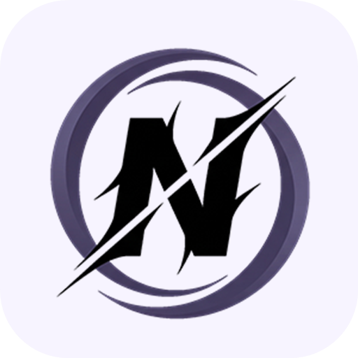
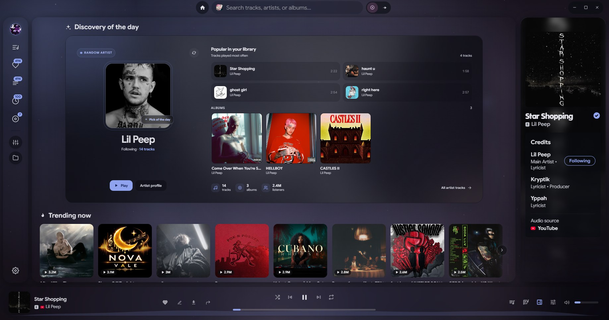
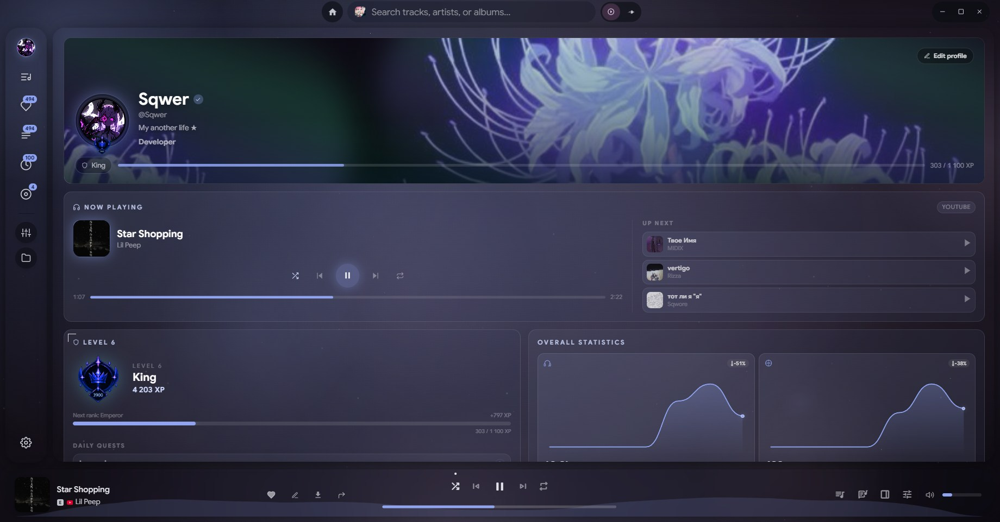
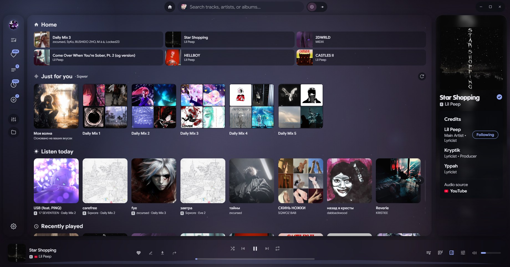

<p align="center">
  
</p>

<h1 align="center">Noctra</h1>

<p align="center">
  <b>Your music. Your space. One desktop experience.</b><br>
  A standalone desktop music player and audio suite that brings streaming
  sources, your local library, and creative audio tools into one place.
</p>

<p align="center">
  <a href="README.md">English</a> · <a href="README.ru.md">Русский</a>
</p>

<p align="center">
  
  
  
  
</p>

**YouTube · YouTube Music · SoundCloud · Deezer · Apple Music · Local files**

No subscription. No ads. No cloud lock-in.

[**Download Noctra**](https://github.com/Sqwer2017/noctra/releases) ·
[Website](https://sqwer2017.github.io/noctra/) ·
[Report an issue](https://github.com/Sqwer2017/noctra/issues) ·
[View source](https://github.com/Sqwer2017/noctra)

> [!NOTE]
> **Early development — version `0.1.0`.** Some features depend on
> third-party services and may change between releases.

---

## Contents

- [Overview](#-overview)
- [Screenshots](#-screenshots)
- [Features](#-features)
- [Listener profile](#-listener-profile)
- [Technology](#-technology)
- [Download & installation](#-download--installation)
- [Build from source](#-build-from-source)
- [Data & privacy](#-data--privacy)
- [Integrations](#-integrations)
- [Roadmap](#-roadmap)
- [Contributing](#-contributing)
- [Credits & license](#-credits--license)

## ✦ Overview

**Noctra** is an independent desktop music player built on the open-source
project [Riff](https://github.com/rootscripts/riff) (MIT). It brings
streaming playback, a local media library, queues, playlists, lyrics, and
audio tools together in one desktop application.

Noctra is **not** an official client of YouTube, YouTube Music,
SoundCloud, Spotify, Apple Music, Deezer, or Last.fm. It does not host or
distribute music catalogs. Playback and metadata rely on the capabilities
made available by the respective services.

## ◈ Screenshots

<p align="center">
  <a href="docs/screenshots/home-1.jpg"></a>
  <a href="docs/screenshots/profile.jpg"></a>
</p>
<p align="center">
  <sub><b>Home · discovery of the day</b></sub>
  &nbsp;&nbsp;&nbsp;&nbsp;&nbsp;&nbsp;
  <sub><b>Listener profile</b></sub>
</p>

<p align="center">
  <a href="docs/screenshots/home-2.jpg"></a>
  <br>
  <sub><b>Home · just for you</b></sub>
</p>

## ✨ Features

| Area | What you get |
| --- | --- |
| **Multiple sources** | YouTube, YouTube Music, SoundCloud, Deezer, Apple Music, and local files |
| **Unified library** | Playlists, queue, favorites, listening history, albums, and artists |
| **Playlist import** | Links to public Spotify, Apple Music, Deezer, YouTube Music, and SoundCloud playlists |
| **Offline listening** | Track downloads, a local media library, and playback without an internet connection |
| **Lyrics** | Synced LRC, plain lyrics, translations, fullscreen mode, and karaoke |
| **Audio tools** | Equalizer, track trimming, tempo, pitch, reverb, and distortion effects |
| **Listener profile** | XP, ranks, achievements, daily quests, statistics, and banner effects |
| **Material Design 3** | Accent colors, themes, animated backgrounds, glass panels, and two home layouts |
| **Integrations** | Discord Rich Presence, Last.fm, and optional Google sign-in for the YouTube library |
| **Local-first data** | No telemetry, analytics, or proprietary account server |

## ♡ Listener profile

Your listener profile is calculated locally from your listening activity.
It is a personal progression system, **not a social network**.

- Earn XP and ranks through listening, favorites, and playlists.
- Unlock achievements with rarity levels and progress tracking.
- Complete daily quests and collect rewards.
- Explore listening statistics, activity streaks, and charts.
- Customize your avatar, banner, status, and bio.
- Choose banner effects: **Stars**, **Fog**, **Aurora**, and **Embers**.

## ⚙ Technology

Noctra is built as an Electron desktop application.

| Component | Technology |
| --- | --- |
| Desktop runtime | Electron 41 |
| Runtime requirement | Node.js 20+ (22 recommended) |
| Package manager | npm |
| Media helpers | `yt-dlp`, `ffmpeg` |

The project is based on [Riff](https://github.com/rootscripts/riff), an
open-source project distributed under the MIT License.

## ↓ Download & installation

The latest available builds are published on the
**[GitHub Releases page](https://github.com/Sqwer2017/noctra/releases)**.

| Platform | Package | Notes |
| --- | --- | --- |
| Windows | NSIS installer | x64 |
| Linux | AppImage | x64 |
| macOS | DMG / ZIP | Experimental; requires additional application signing |

For playback and downloads, Noctra may need `yt-dlp` and `ffmpeg`. The
application can help locate or download them on first launch.

## 🛠 Build from source

### Requirements

- [Node.js 20+](https://nodejs.org/) — Node.js 22 is recommended.
- npm.

### Get the code

```bash
git clone https://github.com/Sqwer2017/noctra.git
cd noctra
npm install
```

### Run in development

```bash
npm start
```

### Create a production build

```bash
npm run dist
```

The production output is generated in `dist/`.

### Check JavaScript syntax

Run these checks before committing changes:

```bash
node --check src/renderer/app.js
node --check src/renderer/profile.js
node --check src/main/main.js
```

## 🔒 Data & privacy

Noctra does not send your listening history or settings to the developer
and does not use telemetry. Your app data stays on your device.

| Platform | Data locations |
| --- | --- |
| Windows | `%APPDATA%\Noctra` and `%LOCALAPPDATA%\Noctra` |
| macOS | `~/Library/Application Support/Noctra` |
| Linux | `~/.config/noctra` and `~/.cache/noctra` |

On first launch, Noctra migrates data from the legacy Riff folder if one
is present. You can create a backup of your account and library from the
application settings.

## ↗ Integrations

- **Discord Rich Presence** — displays the current track, artist, and
  playback time. The application name shown in Discord is configured
  through the Noctra Discord application.
- **Last.fm** — scrobbling support; you can provide your own API keys in
  settings.
- **Google** — optional sign-in for importing your YouTube playlists and
  liked videos.
- **Plugins** — built-in extension system and support for custom themes.

## ◷ Roadmap

Planned areas of development include:

- More stable releases and automatic updates.
- Additional sources and improved search.
- Further development of the offline library and audio tools.
- Expanded listener profiles, achievements, and statistics.
- New themes, icons, and visual effects.
- Developer tools and plugin capabilities.

The roadmap may change as development progresses.

## Contributing

Found a bug or have an idea? Open an issue in the
**[issue tracker](https://github.com/Sqwer2017/noctra/issues)**.

For larger changes, please open an issue to discuss the proposal before
starting implementation. **Never post API keys, tokens, passwords, or
other secrets in public issues.**

## Code signing policy

Free code signing provided by SignPath.io, certificate by SignPath Foundation.
Noctra is solo-maintained; the maintainer holds the Author, Reviewer, and
Signing Approver roles. See [CODE_SIGNING_POLICY.md](CODE_SIGNING_POLICY.md)
and [PRIVACY.md](PRIVACY.md).

## Credits & license

Noctra is built on the open-source project
**[Riff](https://github.com/rootscripts/riff)** (© rootscripts, MIT).
Thanks to the Riff authors for the foundation.

Noctra's changes and additions are distributed under the MIT License.
Noctra is independent of the Riff authors and is not affiliated with,
sponsored by, or endorsed by them. The Riff name is used solely to
identify the origin of the open-source code.

For the full terms, third-party component notices, and legal information,
see [LICENSE](LICENSE) and [NOTICE](NOTICE).

The application is provided **"as is"**, without express or implied
warranties. Users are responsible for complying with third-party service
terms and applicable copyright laws.

---

<p align="center">
  <b>Made for listening, built for freedom.</b><br>
  <sub>Noctra · Open source · MIT License</sub>
</p>
