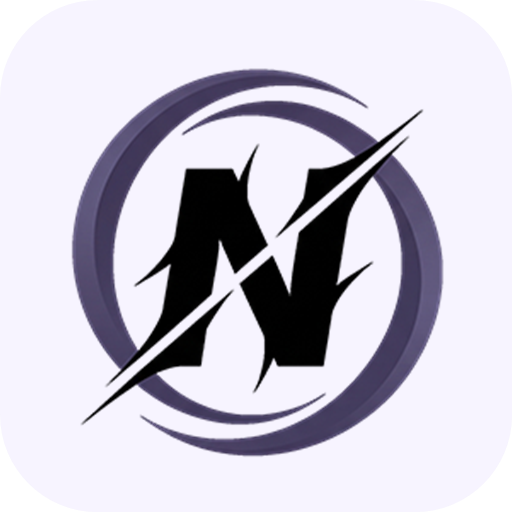
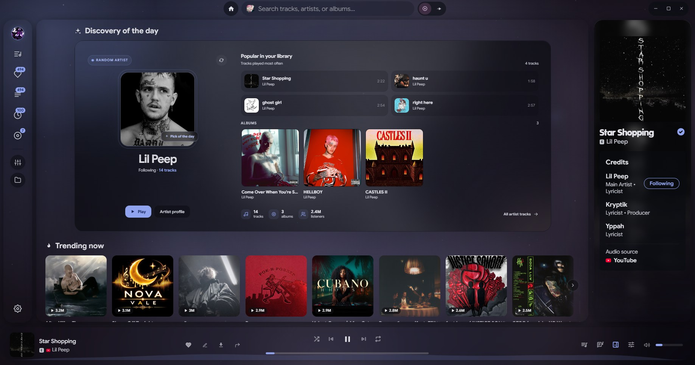
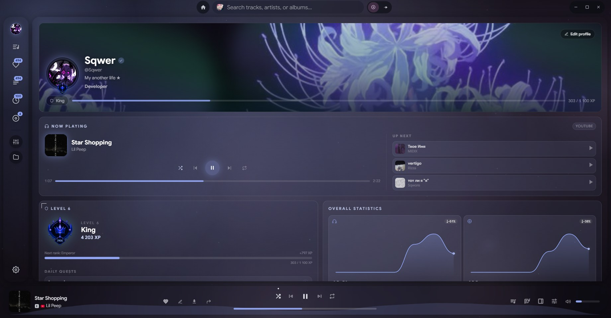
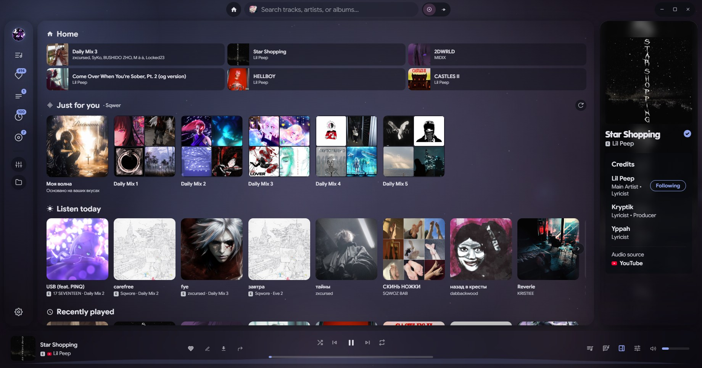

<p align="center">
  
</p>

<h1 align="center">Noctra</h1>

<p align="center">
  <b>Твоя музыка. Твоё пространство. Один десктопный плеер.</b><br>
  Независимый музыкальный плеер и аудио-сьют, объединяющий потоковые
  сервисы, локальную медиатеку и инструменты для работы со звуком.
</p>

<p align="center">
  <a href="README.md">English</a> · <a href="README.ru.md">Русский</a>
</p>

<p align="center">
  
  
  
  
</p>

**YouTube · YouTube Music · SoundCloud · Deezer · Apple Music · Локальные файлы**

Без подписки. Без рекламы. Без привязки к облаку.

[**Скачать Noctra**](https://github.com/Sqwer2017/noctra/releases) ·
[Сообщить об ошибке](https://github.com/Sqwer2017/noctra/issues) ·
[Исходный код](https://github.com/Sqwer2017/noctra)

> [!NOTE]
> **Ранняя стадия разработки — версия `0.1.0`.** Некоторые функции
> зависят от доступности сторонних сервисов и могут меняться между
> релизами.

---

## Содержание

- [О проекте](#-о-проекте)
- [Скриншоты](#-скриншоты)
- [Возможности](#-возможности)
- [Профиль слушателя](#-профиль-слушателя)
- [Технологии](#-технологии)
- [Скачать и установить](#-скачать-и-установить)
- [Сборка из исходников](#-сборка-из-исходников)
- [Данные и приватность](#-данные-и-приватность)
- [Интеграции](#-интеграции)
- [Планы развития](#-планы-развития)
- [Участие в проекте](#-участие-в-проекте)
- [Благодарности и лицензия](#-благодарности-и-лицензия)

## ✦ О проекте

**Noctra** — независимый десктопный музыкальный плеер, основанный на
открытом проекте [Riff](https://github.com/rootscripts/riff) (MIT). Он
объединяет потоковое воспроизведение, локальную медиатеку, очереди,
плейлисты, тексты песен и аудио-инструменты в одном приложении.

Noctra **не является официальным клиентом** YouTube, YouTube Music,
SoundCloud, Spotify, Apple Music, Deezer или Last.fm. Приложение не
хранит и не распространяет музыкальные каталоги. Воспроизведение и
метаданные обеспечиваются доступными возможностями самих сервисов.

## ◈ Скриншоты

<p align="center">
  <a href="docs/screenshots/home-1.jpg"></a>
  <a href="docs/screenshots/profile.jpg"></a>
</p>
<p align="center">
  <sub><b>Главная · открытие дня</b></sub>
  &nbsp;&nbsp;&nbsp;&nbsp;&nbsp;&nbsp;
  <sub><b>Профиль слушателя</b></sub>
</p>

<p align="center">
  <a href="docs/screenshots/home-2.jpg"></a>
  <br>
  <sub><b>Главная · только для тебя</b></sub>
</p>

## ✨ Возможности

| Направление | Что внутри |
| --- | --- |
| **Несколько источников** | YouTube, YouTube Music, SoundCloud, Deezer, Apple Music и локальные файлы |
| **Единая медиатека** | Плейлисты, очередь, избранное, история прослушивания, альбомы и исполнители |
| **Импорт плейлистов** | Ссылки на публичные плейлисты Spotify, Apple Music, Deezer, YouTube Music и SoundCloud |
| **Офлайн-прослушивание** | Скачивание треков, локальная медиатека и воспроизведение без интернета |
| **Тексты песен** | Синхронизированные LRC, обычный текст, перевод, полноэкранный режим и караоке |
| **Аудио-инструменты** | Эквалайзер, обрезка треков, темп, тональность, реверберация и эффекты перегрузки |
| **Профиль слушателя** | XP, ранги, достижения, ежедневные задания, статистика и эффекты баннера |
| **Material Design 3** | Акцентные цвета, темы, анимированный фон, стеклянные панели и два варианта главной |
| **Интеграции** | Discord Rich Presence, Last.fm и необязательный вход Google для библиотеки YouTube |
| **Локальное хранение** | Без телеметрии, аналитики и собственного сервера аккаунтов |

## ♡ Профиль слушателя

Профиль формируется локально на основе истории прослушивания. Это
персональная система прогресса, **а не социальная сеть**.

- Получай XP и повышай ранги за прослушивание, избранное и плейлисты.
- Открывай достижения с уровнями редкости и отслеживанием прогресса.
- Выполняй ежедневные задания и получай награды.
- Изучай статистику прослушивания, серии активных дней и графики.
- Настраивай аватар, баннер, статус и описание.
- Выбирай эффекты баннера: **Звёзды**, **Туман**, **Аврора** и **Угли**.

## ⚙ Технологии

Noctra создан как десктопное приложение на Electron.

| Компонент | Технология |
| --- | --- |
| Десктопная платформа | Electron 41 |
| Требования к среде | Node.js 20+ (рекомендуется 22) |
| Менеджер пакетов | npm |
| Мультимедийные инструменты | `yt-dlp`, `ffmpeg` |

Проект основан на [Riff](https://github.com/rootscripts/riff) —
открытом проекте под лицензией MIT.

## ↓ Скачать и установить

Готовые сборки публикуются на странице
**[GitHub Releases](https://github.com/Sqwer2017/noctra/releases)**.

| Платформа | Формат | Примечания |
| --- | --- | --- |
| Windows | Установщик NSIS | x64 |
| Linux | AppImage | x64 |
| macOS | DMG / ZIP | Экспериментальная сборка; требуется дополнительная подпись приложения |

Для воспроизведения и скачивания Noctra могут понадобиться `yt-dlp` и
`ffmpeg`. При первом запуске приложение помогает найти или загрузить эти
инструменты.

## 🛠 Сборка из исходников

### Требования

- [Node.js 20+](https://nodejs.org/) — рекомендуется Node.js 22.
- npm.

### Получение исходного кода

```bash
git clone https://github.com/Sqwer2017/noctra.git
cd noctra
npm install
```

### Запуск в режиме разработки

```bash
npm start
```

### Production-сборка

```bash
npm run dist
```

Готовая сборка появится в директории `dist/`.

### Проверка синтаксиса JavaScript

Перед коммитом рекомендуется выполнить:

```bash
node --check src/renderer/app.js
node --check src/renderer/profile.js
node --check src/main/main.js
```

## 🔒 Данные и приватность

Noctra не отправляет историю прослушивания и настройки разработчикам и
не использует телеметрию. Данные приложения остаются на устройстве.

| Платформа | Расположение данных |
| --- | --- |
| Windows | `%APPDATA%\Noctra` и `%LOCALAPPDATA%\Noctra` |
| macOS | `~/Library/Application Support/Noctra` |
| Linux | `~/.config/noctra` и `~/.cache/noctra` |

При первом запуске Noctra переносит данные из старой папки Riff, если
она существует. Резервную копию аккаунта и медиатеки можно создать в
настройках приложения.

## ↗ Интеграции

- **Discord Rich Presence** — отображает текущий трек, исполнителя и
  время воспроизведения. Имя приложения в статусе Discord задаётся
  через Discord-приложение Noctra.
- **Last.fm** — скробблинг; в настройках можно указать собственные
  API-ключи.
- **Google** — необязательный вход для импорта своих плейлистов и
  понравившихся видео YouTube.
- **Плагины** — встроенная система расширений и поддержка
  пользовательских тем.

## ◷ Планы развития

Основные направления дальнейшей разработки:

- более стабильные релизы и автоматическое обновление;
- новые источники и улучшенный поиск;
- развитие офлайн-медиатеки и аудио-инструментов;
- расширение профиля слушателя, достижений и статистики;
- новые темы, иконки и визуальные эффекты;
- инструменты для разработчиков и система плагинов.

Планы могут меняться по мере развития проекта.

## Участие в проекте

Нашёл ошибку или хочешь предложить улучшение? Создай обращение в
**[разделе Issues](https://github.com/Sqwer2017/noctra/issues)**.

Перед крупными изменениями лучше сначала обсудить предложение в issue.
**Не публикуй API-ключи, токены, пароли и другие секреты в открытых
обращениях.**

## Благодарности и лицензия

Noctra создан на основе открытого проекта
**[Riff](https://github.com/rootscripts/riff)** (© rootscripts, MIT).
Спасибо авторам Riff за основу проекта.

Изменения и дополнения Noctra распространяются по лицензии MIT. Noctra
не связан с авторами Riff, не спонсируется и не одобряется ими.
Название Riff используется исключительно для указания происхождения
открытого кода.

Полные условия, список сторонних компонентов и юридическая информация
находятся в файлах [LICENSE](LICENSE) и [NOTICE](NOTICE).

Приложение предоставляется **«как есть»**, без явных или подразумеваемых
гарантий. Пользователь самостоятельно отвечает за соблюдение условий
сторонних сервисов и применимого законодательства об авторском праве.

---

<p align="center">
  <b>Создан для музыки. Построен на свободе.</b><br>
  <sub>Noctra · Open source · MIT License</sub>
</p>
